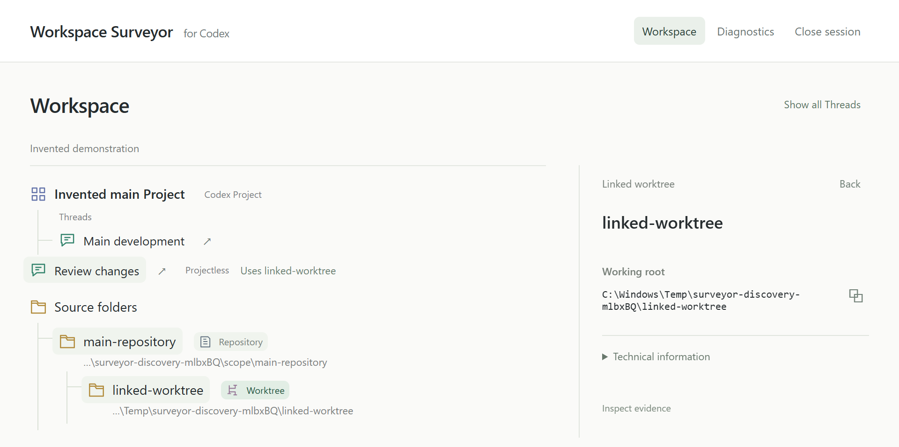

# Workspace Surveyor for Codex

**Understand the relationships between Codex Threads, Local Projects, working folders and Git worktrees.**

Workspace Surveyor is a Windows-first, read-only explorer of Codex relationships. It helps explain shared working locations, stored Project assignments and uncertainty in the available evidence.

**Current status:** a source-checkout preview for native Windows, with reusable sessions, explicit Refresh, conditional instruction metadata and reduced session-reopening friction. The [accepted baseline and scope](docs/roadmap.md#current-position-and-priorities-2026-10-16) are recorded in the roadmap. There is no published package, globally installed command or public API. A license has not been selected; the project is not presented as an open-source release. See [tested scenarios and limits](docs/compatibility.md).

## Why it exists

Several threads can share a working location, Projects can declare overlapping folder roots, and assignments can disagree with stored locations. Workspace Surveyor brings these relationships together before you consider organization changes.

A **stored CWD** is the working-directory string recorded for a thread. It does not prove that the directory exists or is the thread's current runtime location.



*The running Explorer with invented records and disposable Git fixtures. This relationship demo does not show reusable-session Refresh controls. [Capture provenance](docs/getting-started.md#screenshot-provenance).*

## What the explorer shows

- **Workspace:** a light, vertical relationship tree. Assigned Threads nest beneath their Projects; declared roots and unique working folders have explicit connections. Shared locations appear once with references. Verified linked worktrees nest beneath their main repository.
- **Standalone entities:** projectless Threads, unassociated folder roots, empty Projects and missing roots remain visible. Ordinary subdirectories have no browsing UI.
- **Details and Diagnostics:** friendly names, useful paths, explicit copy controls and validated Thread deeplinks, with provenance and technical evidence available when needed. Unresolved current relationships remain reachable; internal, archived and stale records stay in Diagnostics.
- **Conditional instruction metadata:** observed standard instruction-file paths and possible discovery boundaries under a documented default assumption. File presence does not prove Codex selected, loaded or followed instructions; effective Desktop configuration remains unknown.
- **Uncertainty:** missing observations, conflicts and unresolved references remain visible. Matching path strings do not establish Project membership or filesystem identity.

## Launch on Windows

Use a native Windows checkout with Node **24** on PATH, npm **11**, and PowerShell **7**. There are no runtime package dependencies. Git is unnecessary for Explorer observation; it is needed to clone with Git or run the disposable Git demo.

From the repository directory, install the pinned development dependencies and build:

```powershell
npm ci --ignore-scripts --no-audit --no-fund
npm run build
```

Double-click **[Workspace Surveyor.cmd](Workspace%20Surveyor.cmd)**. The default browser opens the UI immediately. A fresh session requests acquisition, which requires Codex and ChatGPT Desktop to be closed normally. If acquisition refuses because Desktop is running, close Desktop normally and click **Refresh**. After success, you may reopen Desktop and inspect the snapshot.

Relaunching a healthy session reopens its successful snapshot with its original **Last updated** time. Use **Refresh** explicitly for newer data. Failed or cancelled refreshes retain the previous successful view. Browser reload reconnects without inspection. **Close session** closes the host and attached views; keep the visible console open until cleanup finishes.

Build again after updates. The [getting-started guide](docs/getting-started.md) covers source selection, discovery scope, session lifetime, standalone launch and recovery troubleshooting.

<a id="run-the-synthetic-demonstration"></a>
## Try the synthetic demo

You can explore invented Projects and Threads without reading personal Codex state. The [demo instructions](docs/getting-started.md#try-the-synthetic-demo) cover the protected-copy browser demonstration, an authentic disposable Git/worktree demonstration and the original bundled text CLI.

## How it works

Selected sources → protected acquisition and separate analysis copies → bounded metadata readers → evidence-bearing relationships → local browser view.

Snapshot publication follows successful verification, helper exit, authenticated copy cleanup and discovery. A temporary authenticated loopback server holds the dataset in memory. Stored strings are rendered as text; paths have no filesystem actions.

## Limits and privacy

The accepted experience is bounded Windows observation, not certification of every Desktop release, source schema or Git layout. Thread visibility remains inferred; missing Project metadata can leave membership unknown. Discovery stays within its invocation scope and finite limits. Standard linked-worktree relationships require reciprocal administrative metadata.

Every acquisition still requires Desktop closure. Live acquisition remains unavailable following [feasibility research](docs/research/live-acquisition-feasibility.md#final-best-effort-feasibility-gate--2026-10-15). Exports, automatic refresh, folder launching and migration actions are unavailable.

Workspace Surveyor does not mutate Codex-owned SQLite or JSON state. There are no uploads, user-data telemetry or external assets. Browser snapshots are memory-only; reusable tabs store only an ephemeral session credential for reconnection. Protected temporary copies and recovery controls have explicit lifecycles. Cleanup covers authenticated owned artifacts; historical residuals remain [disclosed](docs/research/m3a-explorer-preparation.md#validation). Browser memory erasure and protection from external capture are not guaranteed.

## Independent project and documentation

Workspace Surveyor for Codex is an independent community project. It is not an official OpenAI product and is not affiliated with, endorsed by or sponsored by OpenAI.

- [Getting started](docs/getting-started.md) and [documentation index](docs/index.md)
- [Product direction](docs/product.md), [architecture](docs/architecture.md) and [roadmap](docs/roadmap.md)
- [Compatibility and evidence](docs/compatibility.md) and [safety and privacy](docs/safety-and-privacy.md)
- [Contributing](CONTRIBUTING.md) and [security reporting](SECURITY.md)
